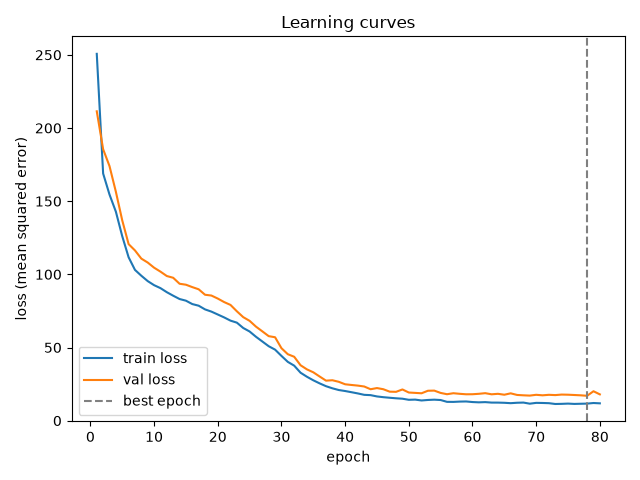
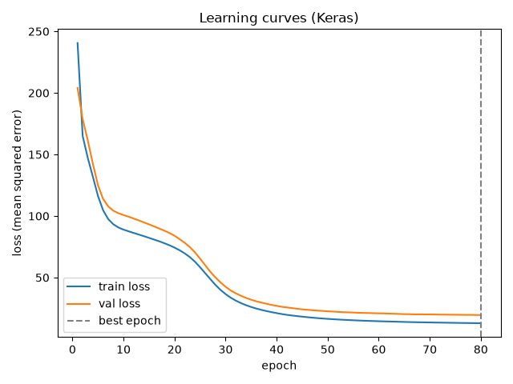

# Lakeshore Bike Demand

## What it does

This project predicts how many bikes will be rented from a station in the coming hour, using the hour, the weather, whether it is a weekend, and the type of station. It trains a small neural network with a training loop written by hand, and it compares that network honestly with two simple baselines. All results are reproduced with one command, `python train.py`.

Lab 08 rebuilds the same network in Keras, proves the two networks are the same function by copying the weights across, trains both fairly, and compares them on three seeds. The Keras run is `python train_keras.py`, and the comparison is `python compare.py`. The write-up, with the recommendation for the scenario team, is in `COMPARISON.md`.

## How to run it

Create the environment and install the packages, then run the training script. Use the terminal in VS Code, not the play button, so the commands run in the right environment.

```bash
conda create -n lab08-same-model-twice python=3.12
conda activate lab08-same-model-twice
pip install -r requirements-dev.txt
python train.py
python train_keras.py
python compare.py
```

That trains the PyTorch network, the Keras network, and the three-seed comparison, and writes every result to `reports/`.

`requirements.txt` pins `ml-dtypes` to 0.5.3, because version 0.7.0 would not load on the laptop used for this lab: Windows Application Control blocked its extension file. The pin is in the requirements file so a fresh install gets the working version.

### Run

`python train.py` trains the PyTorch network, runs the two baselines and the three experiments, and takes about two minutes on a CPU. `python train_keras.py` trains the Keras version and takes about a minute. `python compare.py` trains the main configuration in both frameworks on three seeds and takes a few minutes. Each script prints its progress and its best epoch and MAE numbers.

### Check it

From a fresh clone, with the environment active, run these three checks. All three must pass with no errors.

```bash
python -m ruff format --check
python -m ruff check
python -m pytest
```

Then run `python train.py`, `python train_keras.py` and `python compare.py`, and check that they recreate the files in `reports/` with the numbers in this README and in `COMPARISON.md`.

### Settings

The main run uses 80 epochs, batch size 64, Adam with learning rate 0.003, hidden size 32, and seed 42. The split is 60/20/20 with seed 42. These settings are at the top of `train.py` and in `prepare.py`, and they are listed in the Model and training section below.

The Keras run uses the same settings: the same split and the same prepared arrays from `prepare.py`, the same loss, optimizer, learning rate, batch size and seed. `keras.utils.set_random_seed` is called before the model is built. EarlyStopping watches the validation loss with patience equal to the number of epochs, so the run never stops early, and it restores the best weights. A ModelCheckpoint saves the best model to `reports/best_keras_model.keras`, which is not committed; rerun `python train_keras.py` to recreate it.

### Errors and exit codes

There are no custom exit codes in this project. Python and pytest use their normal exit codes: 0 means success, and a non-zero code means an error. The most common errors are a missing environment, which gives `ModuleNotFoundError: No module named 'torch'`, and a shape mismatch, which names the two shapes that do not agree. If `python train.py` fails, read the last error message first, it usually names the file and the line.

On this laptop, TensorFlow failed at first with an `ImportError` for `ml_dtypes`, because Windows Application Control blocked its extension file. The fix was `ml-dtypes==0.5.3`, pinned in `requirements.txt`. TensorFlow also prints startup warnings about oneDNN and GPU support on Windows; those are normal and do not affect the results.

## Data and split

The data come from `bikes_data.py`, which is given code and was not edited. It builds 6,000 invented station-hours with a fixed seed, so everyone works from the same table. Each row has the hour (0 to 23), temperature in degrees Celsius, rain in millimetres, wind in kilometres per hour, whether it is a weekend (0 or 1), the station type (downtown, residential, or park), and the number of rentals, which is the target. Rentals range from 0 to 105, with a mean of 10.59.

The table is split 60/20/20 with a fixed seed of 42: 3,600 training rows, 1,200 validation rows, and 1,200 test rows. The split is made before any preparation. The scaler and the one-hot encoder are fitted on the training rows only, so the validation and test rows do not leak into training. That matters because the scaler learns the training means, and if it learned them from all the rows, the validation and test results would look better than they really are.

After preparation, each row has 8 features: 5 scaled numbers (hour, temperature, rain, wind, is weekend) and 3 one-hot columns for the station type. The labels are the rental counts.

## Model and training

The network, `BikeNet` in `model.py`, is an `nn.Module` with two hidden layers of 32 units each, ReLU between them, and a final layer that ends in one value with no activation, because the target is a count, not a probability. It has 1,377 weights and biases.

The loss is `nn.MSELoss`, mean squared error, which is the right loss for a count. The optimizer is Adam with learning rate 0.003, the rate used in the Module 07 worked example. Batches have 64 rows, and the training loader shuffles them with a seeded generator, while the validation and test loaders do not shuffle.

The training loop is written by hand in `train.py`. One epoch takes a batch, runs the forward pass, computes the loss, then runs `optimizer.zero_grad()`, `loss.backward()`, and `optimizer.step()`. The epoch function trains when it is given an optimizer and only measures otherwise, and it returns the mean loss and the mean absolute error in rentals. The training function runs for 80 epochs, logs the training loss, the validation loss, and the validation MAE for every epoch, and puts back the weights from the epoch with the lowest validation loss, which was epoch 78.

The seed is fixed in `train.py`: PyTorch and the DataLoader generator both use seed 42, and the split uses seed 42. Running `python train.py` twice on the same computer gives identical numbers, which was checked by running it twice and comparing the report files.

## Keras version

`keras_model.py` builds the same network with `keras.Sequential`: an `Input` layer, two `Dense` layers of 32 units with ReLU, and a final `Dense` layer with one value and no activation. The hidden size is configurable. The parameter count equals the PyTorch network's at every hidden size tested: 433, 1,377 and 4,801 for hidden sizes 16, 32 and 64.

`copy_weights` in the same file copies the weights from a PyTorch `BikeNet` into the Keras model. A PyTorch weight has shape (outputs, inputs) and a Keras Dense kernel has shape (inputs, outputs), so each weight is transposed and the biases copy straight across. After the copy, the largest prediction difference on the 1,200 validation rows was 3.73e-08, which is floating point rounding, so the two networks are the same function with the same weights. The test in `tests/test_keras.py` checks this within a stated tolerance of 1e-4.

`train_keras.py` compiles the model with Adam at learning rate 0.003, mean squared error loss and MAE as a metric, then fits it with the EarlyStopping and ModelCheckpoint callbacks described in Settings. It writes `history_keras.csv` and `learning_curves_keras.png` beside the PyTorch reports. The checkpoint file itself is not committed; `.gitignore` excludes it, and rerunning the script recreates it.

## Results

| Model | Validation MAE (rentals) | Test MAE (rentals) |
| --- | --- | --- |
| Training mean baseline | 10.15 | 9.65 |
| Linear regression baseline | 9.32 | 8.57 |
| Network, best epoch 78 | 2.73 | 2.60 |

The network is far better than both baselines, by about 7 rentals on validation and about 6 to 7 rentals on test. The test result was measured once, at the end, after the best epoch was chosen using the validation rows only.

The linear model does not do well on this table because rentals do not change in a straight line with the hour. Plotting rentals against the hour shows bumps, not a line: rentals average about 3 overnight, rise to 23.1 at 8am, fall to 8.0 at 1pm, rise again to 22.2 at 6pm, and fall back to about 3 overnight, and the pattern changes with the station type. A straight line cannot describe two peaks and a dip, so the linear model misses most of the pattern, while the network, with ReLU bends between its layers, can follow it.



The curves show a healthy run. Both the training loss and the validation loss fall steeply for the first 35 epochs, from about 250 to about 25, then flatten and fall slowly together, with the training loss just below the validation loss. The gap between them stays small, so the network is not strongly overfitting. The best epoch is 78, marked with a dashed line, which is near the end of training, so a few more epochs might help a little, but the validation loss is noisy late in training, with a jump at epoch 79, so the best-epoch weights are the ones to keep.

The Keras version of the main run, on seed 42, reached best epoch 80, validation MAE 3.05 and test MAE 2.88.



## Comparison summary

`compare.py` trains the main configuration in both frameworks on three seeds, using the same split for both frameworks on each seed. The full table is in `reports/comparison.csv`.

| Framework | Seed | Best epoch | Validation MAE | Test MAE | Seconds |
| --- | --- | --- | --- | --- | --- |
| PyTorch | 42 | 78 | 2.74 | 2.61 | 5.3 |
| Keras | 42 | 80 | 3.05 | 2.88 | 9.7 |
| PyTorch | 123 | 80 | 2.61 | 2.68 | 5.8 |
| Keras | 123 | 80 | 2.82 | 2.87 | 8.1 |
| PyTorch | 2026 | 79 | 3.04 | 2.96 | 5.7 |
| Keras | 2026 | 80 | 3.20 | 3.10 | 7.5 |

PyTorch scored better on test MAE and trained faster on all three seeds. The recommendation, what the team gives up, and the condition that would change it are in `COMPARISON.md`.

## Experiments

Each experiment changes one thing from the main run. The table uses the best validation MAE, the epoch where it happened, and the final training and validation loss.

| Run | Hidden | Learning rate | Best epoch | Best val MAE | Final train loss | Final val loss |
| --- | --- | --- | --- | --- | --- | --- |
| Main | 32 | 0.003 | 78 | 2.73 | 11.82 | 17.86 |
| Learning rate too small | 32 | 0.0001 | 80 | 8.50 | 142.28 | 166.20 |
| Learning rate too large | 32 | 0.03 | 44 | 2.72 | 15.12 | 18.24 |
| Wider network | 128 | 0.003 | 78 | 2.57 | 10.11 | 15.95 |

Learning rate too small is underfitting. After 80 epochs the loss is still 142 on training and 166 on validation, and the best epoch is the last one, which means training had barely begun. The steps were too small to reach the valley.

Learning rate too large is unstable, not simply better. Its best validation MAE, 2.72, is almost the same as the main run, but its curves jump around, with the validation loss jumping from about 17 to about 34 in one epoch, and its final validation loss, 18.24, is worse than the main run. It learns fast at first, then overshoots.

The wider network, with 128 hidden units and 17,793 weights instead of 1,377, is fine, with a small gain. Its best validation MAE is 2.57, a little better than the main run, and its training loss is lower, 10.11 against 11.82, so it fits the training rows a little more. The gain is small for thirteen times as many weights, and the gap between training and validation loss is a little wider, so the extra size is not clearly worth it on 3,600 training rows.

## Limitations

The data are invented, not real bike share records, so the model describes this invented table, not Toronto or any real city. It cannot see anything that is not in the table: no holidays, no events, no road closures, no broken bikes, and no station capacity, so a planner should not use it to decide where to move bikes on a day with an event or a closure. The counts are noisy, and the model is often off by about 3 rentals, which is large for a quiet station that usually rents 3 bikes, and small for a busy downtown station at 8am. The test result is one number from one invented table, and it would change on a different table or in a different season.

## Reproducing a run

Delete the `reports/` folder, run `python train.py`, `python train_keras.py` and `python compare.py` again, and compare the new files with the committed ones. On the same computer the numbers are identical. On another computer they may differ in the last digits, because the framework versions and the hardware can change the last digits, even with the same seed.

## What the tests cover

There are 23 tests in `tests/`, run with `python -m pytest`: the 12 Lab 07 tests, plus 11 Keras checks from 8 new test functions in `tests/test_keras.py`, one of them parametrized. The Lab 07 tests cover the 9 items in the Lab 07 PDF: the Dataset length, shapes and dtypes; the split sizes and no overlap between splits; the scaler fitted on the training rows only; the training loader shuffling repeatably with a seed; the network returning one value per row for hidden sizes 4, 16, 32 and 64, using `pytest.mark.parametrize`; one optimizer step changing every layer; the network memorizing one small batch; a validation epoch leaving the weights unchanged; and the training function returning one history row per epoch and restoring the best weights. The memorize test is the one that would fail if the gradients were never cleared or the optimizer step were missing, because the loss on one small batch would not fall to less than a fifth of where it started.

The Keras tests cover the Keras network returning one value per row; the parameter count matching PyTorch for hidden sizes 8, 16, 32 and 64, using `pytest.mark.parametrize`; the weight copy giving the same predictions on validation rows within 1e-4, with inputs chosen so the test would fail if the copy forgot the transpose; both frameworks using the same rows; the Keras network memorizing one small batch; a saved and reloaded Keras model giving the same predictions; the best weights being restored; and the same seed repeating a short run.

## Known limitations

The main run was chosen using the validation rows, and the best epoch was 78 of 80, so the network was still improving slowly at the end of training. The validation loss is noisy late in training. The wider network is slightly better on validation, but it was not chosen as the main run because the gain is small for the extra size. The linear baseline uses the same prepared features as the network, and the mean baseline uses the training mean only. No dropout or weight decay was used, and no early stopping rule was used other than restoring the best epoch.

The Keras runs reached their best epoch at 80 on all three seeds, so Keras was still improving when training stopped. The comparison covers three seeds only, on one invented table. The ModelCheckpoint file is not committed, and `ml-dtypes` is pinned to 0.5.3 because version 0.7.0 would not load on the laptop used for this lab.
